# RIDDIM manual

Version 0.1 · for the M-VAVE FM-1 · [First steps (PDF)](docs/riddim-first-guide.pdf) · [Primeiros passos (PDF)](docs/riddim-guia.pdf)

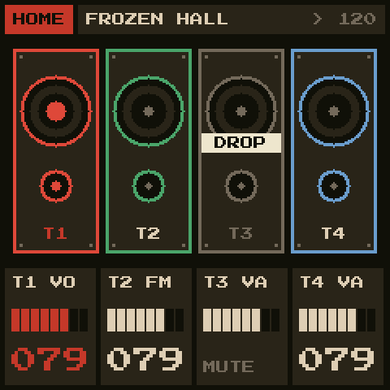

RIDDIM 0.1 is in development: the drums are here (the DRUM source and nine kits); the drum styles that play by
themselves, the band's lines (skank, bubble, bass) and the dub desk are the next versions ([PLAN.md](PLAN.md)). This
manual covers what 0.1 does, and grows with it.

---

## 1. The basics

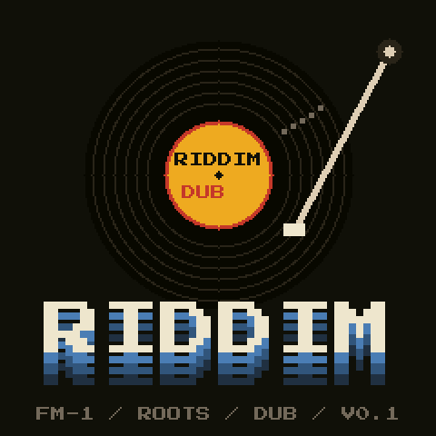

RIDDIM has **four tracks (T1–T4)**. Each track plays one sound, has its own sequence, and goes through the shared
effects. Six voices are shared by all four tracks; a DRUM track plays from its own ten hits instead (see
[DRUM](#drum-the-roots-kit)).

**The controls you use all the time:**

| Control | What it does |
|---|---|
| **ALGORITHM** knob | Picks the track you're working on (T1–T4). Every page shows that track. |
| **PRESETS** knob | Loads the next or previous sound into the selected track. (On the sequencer pages it sets the tempo instead.) |
| **SELECT** knob | On HOME: tempo. On MIXER 1: picks the tile. On the sequencer: moves the cursor. |
| **KNOB 1–4** | The four values at the bottom of the screen, whatever page you're on. |
| **MASTER** knob | Volume. Its top quarter adds up to 6 dB more; a limiter keeps the output from ever clipping. |
| **OCT− / OCT+** | Octave down / up. In save menus: back / confirm. |
| **Keys** | Play the selected track. On a DRUM track each key is a drum. |

**How buttons work:** tap a button to open its first page; tap it again for its next page. The header always shows
where you are, e.g. `SEL > CHORD`. Many buttons also do something when **held** while you press a key or turn a knob
(see [Combos](#12-combos-at-a-glance)).

**Knobs speed up:** turn slowly for fine steps, quickly to sweep the whole range.

**Saving is automatic:** when the sequencer is stopped and you haven't touched anything for 2.5 seconds, RIDDIM saves
your work. Switch off any time; it comes back exactly as you left it. It never saves while something is still
sounding (a note, a drum's tail), to avoid audio dropouts; the header says `SAVES WHEN SILENT` for 2 seconds when it
starts waiting. With an effect tail that never ends (DELAY feeding back, SPACE on INF, GRAIN frozen) saves, sample
uploads and editor writes go ahead 10 seconds after the last note. While a computer records the FM-1 over USB,
autosave waits until you have left the FM-1 alone for 60 seconds, and saves straight away when the recording stops.

**Undo:** hold **EDIT** and press **OCT−** to undo the last edit, **OCT+** to redo it.

**Its own memory:** RIDDIM keeps its own sounds, projects, settings and samples, and does not read another
firmware's. At the first start it writes its four factory samples into any sample slot that is empty or holds
something that cannot play (the boot screen says `INSTALLING SAMPLES`, then the header `SAMPLES RESTORED`). A slot
with a working sample is never touched.

---

## 2. HOME

The main screen is the sound system: **a speaker box a track**, in the track's ink (T1 red, T2 green, T3 gold, T4
blue). The cones push with what the track is playing (after its LEVEL, so a quiet track pushes less); a silent track
(muted, or not the soloed one) goes dark and wears a strip of tape: **DROP**. The selected track's label is in the
accent colour. The header shows the selected track and its sound by name, with the tempo and the battery on the right.

**HOME's knobs act on the selected track:**

| KNOB 1 | KNOB 2 | KNOB 3 | KNOB 4 |
|---|---|---|---|
| VOLUME | CUTOFF | RESONANCE | FX |

- **CUTOFF / RESONANCE:** a filter at the end of the track, for every source: a low-pass unless MIXER 2 says
  otherwise. Fully open = no filtering.
- **FX:** turns all five of the track's effect sends (MIXER 1's DELAY, REVERB, TAPE, GRAIN, DRIVE) up or down
  together. 0 = dry, 100 % = as set on MIXER 1, 200 % = twice as wet.
- **CUT and DRY:** a small red **CUT** under a track's name means its filter is closed (nothing gets through); a red
  **DRY** means its FX is at 0, so it gets no effects although a send is up. On MIXER 1 such a track's send tiles are
  dimmed and show **FX0**.

Press **HOME** again for the mixer pages:

| Page | KNOB 1 | KNOB 2 | KNOB 3 | KNOB 4 |
|---|---|---|---|---|
| MIXER 1 | the tile SELECT picks | | | |
| MIXER 2 | PAN | TYPE | POS | |

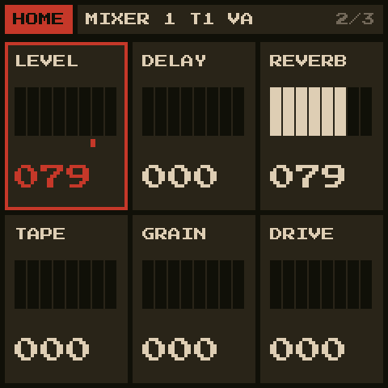

- **MIXER 1** is six tiles for the selected track: **LEVEL**, **DELAY**, **REVERB** on top, **TAPE**, **GRAIN**,
  **DRIVE** below. Turn **SELECT** to move the outline from tile to tile; **KNOB 1** sets the outlined tile.
- **LEVEL:** the bar is a live meter, its top two segments red at the peak; the notch under it marks where LEVEL is
  set.
- **DELAY, REVERB, GRAIN:** how much of the track goes to DELAY, SPACE and GRAIN. For dub, send the cross-stick's track
  to DELAY and SPACE.
- **DRIVE send:** sends the track to a drive of its own (the DRIVE page's TYPE and TONE), even when the DRIVE page's
  AMOUNT is 0, so you can drive one track and leave the others clean.
- **TAPE:** how much of this track goes through the tape (0 = untouched). It uses the TAPE page's WOW, SATURATION and
  TONE; HISS plays while at least one track uses it. WOW is random tape slips: the pitch stays steady, then every few
  seconds the tape jerks or sags off and back.
- **TYPE** (MIXER 2): the track filter is a low-pass (`LP`), high-pass (`HP`) or band-pass (`BP`).
- **POS** (MIXER 2): `PRE`: the effect sends hear the filtered sound. `POST`: only the track's dry sound is filtered;
  GRAIN, DELAY and SPACE hear it unfiltered.

---

## 3. Sounds: EDIT

**EDIT** opens the selected track's sound. Pages: **SOUND → SOURCE** (FM and PHASE tracks have more, see below).

### SOURCE page

| KNOB 1 | KNOB 2 | KNOB 3 | KNOB 4 |
|---|---|---|---|
| SOURCE: VA, FM, SAMPLE, DRUM, WHEEL, PHYS, PHASE | LATCH: OFF / ON | – | GLIDE: OFF, 10 MS – 2.5 S |

- **LATCH OFF:** a note sounds while you hold the key. **LATCH ON:** press once to start a note, again to stop it.
  **Hold SEL + OCT+** switches the selected track's LATCH from any page. A sound you load brings its own LATCH, unless
  SYSTEM 3's LATCH is ALWAYS OFF.
- **GLIDE:** each new note starts at the pitch of the track's last note and slides to its own (10 ms – 2.5 s).
- A DRUM track has no LATCH or GLIDE: its notes are hits.

### SOUND page: the source's four knobs

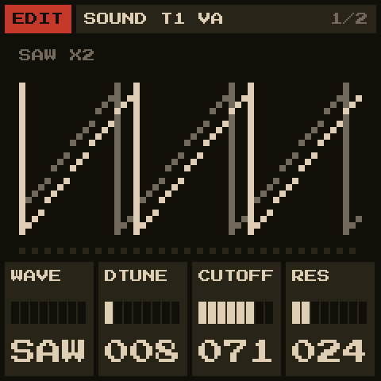

| Source | KNOB 1 | KNOB 2 | KNOB 3 | KNOB 4 | What it is |
|---|---|---|---|---|---|
| **VA** | WAVE | DETUNE | CUTOFF | RESONANCE | Analog-style: saw, square, supersaw. The sub bass, the skank's chop |
| **FM** | PATCH | BRIGHT | DECAY | DETUNE | 6-operator FM; PATCH loads a starting point (BELL, ORGAN, SOFT PAD, REED) |
| **SAMPLE** | SLOT | START | LENGTH | REVERSE | A sample slot (1–4) played as a loop; the key sets the speed, like tape |
| **DRUM** | KIT | TUNE | DECAY | HUMAN | The roots kit: [below](#drum-the-roots-kit) |
| **WHEEL** | DRAWBARS | PERC | CLICK | DRIVE | Tonewheel organ with rotary speaker: the bubble's organ |
| **PHYS** | MODEL | STRUCTURE | DAMP | BOW | Bowed and struck strings, bars, plates, membranes |
| **PHASE** | WAVE | WAVE2 | DCW | DETUNE | CZ-style phase distortion |

### DRUM: the roots kit

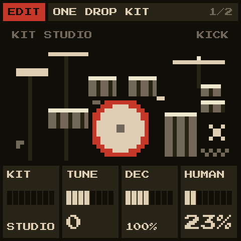

DRUM is a roots reggae drum kit, every drum synthesized (no samples): each hit is a tone and a filtered noise,
each with its own decay; the spring adds its rattle, the shaker a soft attack. The page draws the kit and lights the
piece you just hit; its caption shows the KIT and the drum's name.

| KNOB 1 | KNOB 2 | KNOB 3 | KNOB 4 |
|---|---|---|---|
| KIT: STUDIO, YARD, DUB, STEPPERS | TUNE: −12 … +12 semitones | DECAY: 25 % … 400 % | HUMAN: 0 … 100 % |

- **KIT:** **STUDIO** (dry, as built), **YARD** (a little lower and longer: the room), **DUB** (tight and high, room
  left for the spring and the echo), **STEPPERS** (a lower, longer kick for every beat). It changes the kick's, the
  snare's and the toms' tuning and decays.
- **TUNE** moves the whole kit; **DECAY** stretches or shortens every drum.
- **HUMAN:** each hit a little later (up to ~9 ms), softer and off-pitch, at random: the drummer sits behind the beat.
- **The keys** (the same at any octave; MIDI notes outside F3–G5 fold in by two octaves):

| Key | Drum | Key | Drum | Key | Drum |
|---|---|---|---|---|---|
| F3 | KICK | C4 | TOM LO | A4 | SYN LO |
| F#3 | HAT | C#4 | SHAKER | A#4 | STICKS |
| G3 | CROSS (the cross-stick) | D4 | TOM MID | B4 | SPRING (the tank shaken) |
| G#3 | PEDAL HAT | D#4 | COWBELL | C5 | FLOOR TOM |
| A3 | SNARE | E4 | TOM HI | C#5 | CROSS HI |
| A#3 | OPEN HAT | F4 | STEP KICK | D5 | TIMBALE |
| B3 | RIMSHOT | F#4 | WOOD | D#5 | RIDE |
| | | G4 | SYNDRUM | E5 | CRASH |
| | | G#4 | SYN HI | F5 | DUB KICK |
| | | | | F#5 | SNARE HI |
| | | | | G5 | SPRING HI |

- A drum hit again cuts the one still sounding, and the three hats cut each other (the closed hat stops the open one),
  as on a real kit.
- **Its own hits:** a DRUM track plays from its own ten hits, never the six voices the other tracks share, so drums
  never steal notes from the bass or the keys. Chords, the scale and the octave don't apply: a key is a drum.
- **The sequencer** writes a drum by its key (its note number), **GENERATE** plays random drums, the **arpeggiator**
  rolls them; **VELOCITY** (SYSTEM 3) makes MIDI notes play soft or hard (ghost notes, accents).
- **The one drop:** CROSS and KICK together on beat 3 (the ninth sixteenth), HAT on the eighths, nothing on beat 1.
  **Rockers:** KICK on 1 and 3. **Steppers:** STEP KICK on every beat. Send the CROSS's track to DELAY for the dub
  echo.

### FM editor (FM tracks only)

On an FM track, EDIT steps **SOUND → FM ALGO → FM OP → SOURCE**.

| Page | KNOB 1 | KNOB 2 | KNOB 3 | KNOB 4 |
|---|---|---|---|---|
| FM ALGO | ALGO (1–32) | FEEDBACK | OP (picks operator 1–6) | FINE (that operator) |
| FM OP | RATIO | LEVEL | ATTACK | DECAY |

| FM ALGO | FM OP |
|---|---|
| 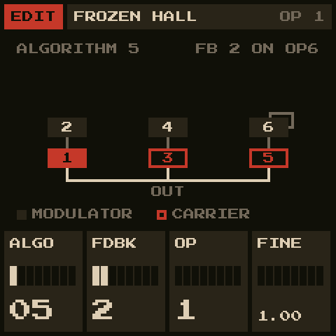 | 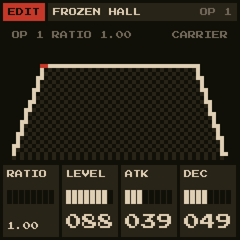 |

The screen draws how the six operators are wired: carriers outlined in colour, modulators dark, the selected operator
lit. Turning PATCH on the SOUND page loads a fresh starting point over your edits (undo brings them back).

### PHASE's LINE 2 and PHASE ENV pages

On a **PHASE** track, EDIT has two more pages after SOURCE. **LINE 2** gives the second line its own **WAVE** and
**DCW**, **RING** (line 1 × line 2) and **NOISE**, as on a Casio CZ. **PHASE ENV** adds a DCW envelope and a pitch
envelope to every note (DCW ENV, DCW DECAY, PITCH ENV −64 … +63 semitones, PITCH DECAY): short for a pluck or a zap,
long for a falling siren. With everything at SAME / OFF a PHASE sound plays as it was made.

### PHYS models

| MODEL | What it is | STRUCTURE | DAMP | BOW |
|---|---|---|---|---|
| MODAL | a bar, bell or plate | harmonic → inharmonic | how long it rings | 0: struck; up: kept sounding |
| STRING | a plucked string | a buzzy bridge → a stiff string | as MODAL | 0: plucked; up: kept sounding |
| MEMBRANE | a struck drum head | HARM: ideal → tuned | as MODAL | BEND: the pitch drop after the strike |
| SYMPATH | a string with three ringing along | CHORD of the sympathetic strings | as MODAL | BUZZ: a buzzing bridge |

PHYS plays at most four notes at once (it is the heaviest source).

The four sample slots come with four factory samples: **1 URCHIN, 2 LEAVE, 3 NIKOLAI, 4 M-SOFT**. Replace them with
your own from the [editor](#14-the-editor).

---

## 4. ENV and LFO

**ENV** (per track): how each note starts and ends. (A DRUM track has its own decays: ENV doesn't apply.)

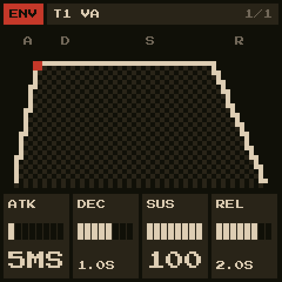

| KNOB 1 | KNOB 2 | KNOB 3 | KNOB 4 |
|---|---|---|---|
| ATTACK (1 ms – 10 s) | DECAY (10 ms – 10 s) | SUSTAIN | RELEASE (10 ms – 20 s) |

**LFO** (per track): slow movement. It runs all the time and never restarts with a note.

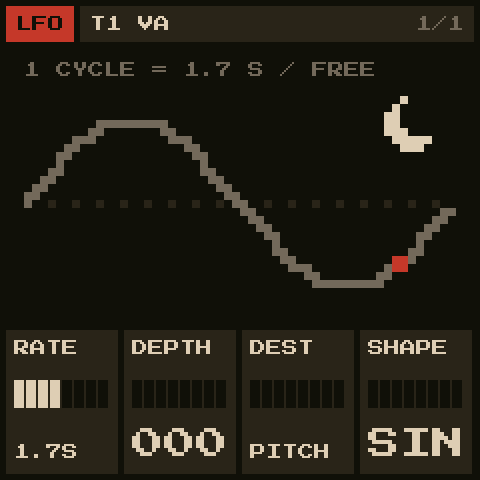

| KNOB 1 | KNOB 2 | KNOB 3 | KNOB 4 |
|---|---|---|---|
| RATE (60 s per cycle – 20 Hz) | DEPTH (0 = off) | DESTINATION | SHAPE |

- **Destinations:** PITCH, VOLUME, PAN, the source's four knobs (by name), REV SEND, GRAIN SEND, the track filter's
  CUTOFF.
- **Shapes:** SINE, TRIANGLE, SAW UP, SAW DOWN, SQUARE, RANDOM (stepped), DRIFT (slow uneven wander)

---

## 5. Scales and chords: SEL

**SEL** opens **SCALE → CHORD**. **Hold SEL** (and let go) to switch **chord mode** on or off for the selected track.

| SCALE | CHORD |
|---|---|
| 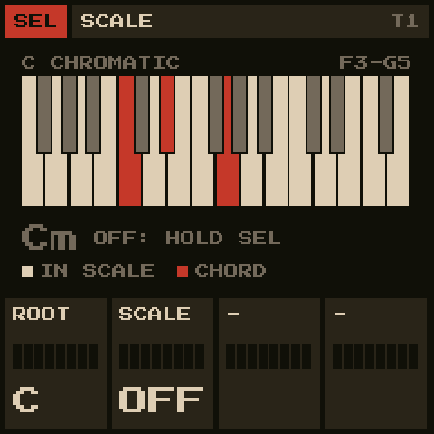 | 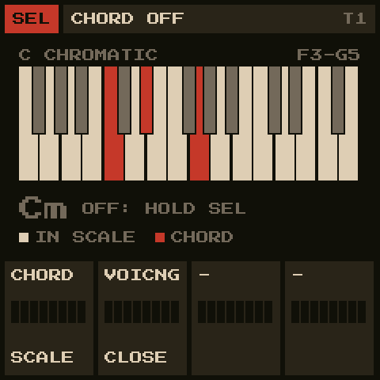 |

| Page | KNOB 1 | KNOB 2 |
|---|---|---|
| SCALE | ROOT (C–B) | SCALE |
| CHORD | CHORD TYPE | VOICING |

- **SCALE** (shared by all tracks): OFF, NATURAL MINOR, MAJOR, DORIAN, PHRYGIAN, LYDIAN, MIXOLYDIAN, LOCRIAN, HARMONIC
  MINOR, PHRYGIAN DOMINANT, HUNGARIAN MINOR, DOUBLE HARMONIC, MINOR PENTATONIC, MAJOR PENTATONIC. With a scale set,
  every key snaps to the nearest note in it (not on a DRUM track). Roots reggae lives in minor and dorian.
- **CHORD TYPE** (per track): SCALE (the scale's own chord on that note), MIN, MAJ, SUS2, SUS4, FIFTH, MIN7, MAJ7, DIM,
  ADD9, CLUSTER. **VOICING:** CLOSE, OPEN, SPREAD, +OCT, DROP.

With chord mode on, one key plays the whole chord: the skank's chord on one finger. Big chords use more of the six
voices; close voicings leave the most room.

---

## 6. Arpeggiator: ARP

**ARP** opens the page; **hold ARP** to switch it on or off for the selected track.

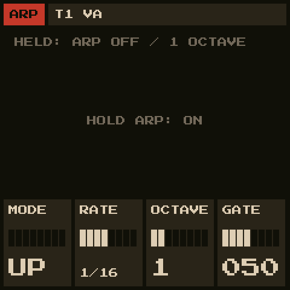

| KNOB 1 | KNOB 2 | KNOB 3 | KNOB 4 |
|---|---|---|---|
| MODE | RATE | OCTAVES (1–4) | GATE |

- **Modes:** UP, DOWN, UP-DOWN, RANDOM, AS PLAYED, CHORD. **Rates:** 1/1 to 1/32, plus triplets.
- It plays the keys you hold (with chord mode: whole chords); with **LATCH ON** it keeps running after you let go. It
  follows the sequencer's clock when playing, otherwise the tempo. Mode CHORD at 1/8 with a short GATE is a quick
  organ bubble.

---

## 7. Sequencer: SEQ, PLAY, REC

Every track has its own 64-step pattern. All four play together on one tempo.

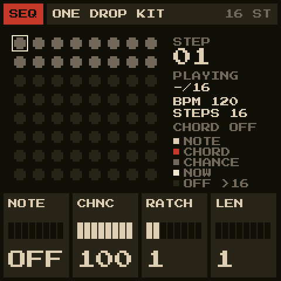

**SEQ** opens **GRID → PATTERN SETTINGS**. **PLAY/STOP** starts and stops. **REC** records.

| Page | KNOB 1 | KNOB 2 | KNOB 3 | KNOB 4 |
|---|---|---|---|---|
| GRID (the selected step) | NOTE (all the way down = OFF) | CHANCE | RATCHET (1–4 hits) | LENGTH (in steps) |
| PATTERN SETTINGS | STEPS (1–64) | DIVISION | SWING | PLAY MODE (FORWARD, BACKWARD, PINGPONG, RANDOM) |

- **SELECT** moves the cursor; **hold SEQ + turn SELECT** changes the pattern length. **PRESETS** sets the tempo.
- **Stopped + REC:** each key writes its note into the selected step and moves on. **Playing + REC:** what you play
  lands on the nearest step. **Hold REC** (~1 s) clears the selected track's pattern (EDIT + OCT− brings it back).
- **SWING** gives the sixteenths the roots lilt; **RATCHET** on a hat step makes a quick double.
- **Step locks:** on the sequencer pages, **hold SEL** and the four knobs become the track's sound knobs; turn one to
  lock that value to the selected step. **Hold SEL + OCT−** clears them.

**Tools: hold SEQ + a white key** (selected track, all undoable):

| F3 | G3 | A3 | B3 | C4 | D4 | E4 | F4 |
|---|---|---|---|---|---|---|---|
| CLEAR | RANDOM | SHIFT ← | SHIFT → | COPY | PASTE | DOUBLE | MUTATE |

---

## 8. Slots and songs: SAVE, GLO

**Slots A–D** hold the four tracks' sounds, sequences and mix (tempo and effects are shared).
**Hold SAVE + C4–F4** saves into A–D (press again within 3 s to overwrite a used slot); **hold SAVE + F3–B3** recalls
A–D (while playing: on the next bar). **SAVE → PROJECTS:** SLOT and ACTION (LOAD, SAVE, ERASE, NEW), confirmed with
**OCT+**.

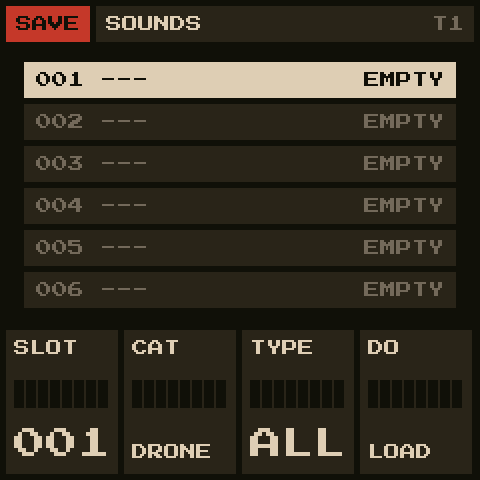

**SAVE → SOUNDS:** 64 slots for your own sounds. KNOB 1 SLOT, KNOB 2 CATEGORY, KNOB 3 TYPE (filters by source),
KNOB 4 ACTION (LOAD / SAVE / CLEAR); **OCT+** confirms. Saved sounds appear in PRESETS after the factory sounds of
their category; name them in the [editor](#14-the-editor) (up to 10 characters).

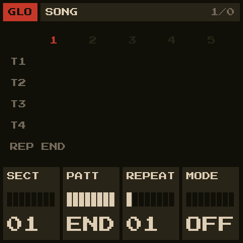

**GLO** opens **SONG**: a chain of up to 16 steps, each a slot and how many times it plays (SECTION, PATTERN, REPEATS,
MODE: OFF, SONG, SONG LOOP). To record one: on the SONG page press **REC**, then **PLAY**, and switch slots with hold
SAVE + F3–B3; STOP ends it.

**Mute and solo: hold GLO + a white key.** F3–B3 mute T1–T4, C4–F4 solo T1–T4. A muted track's box on HOME wears
DROP: the dub's first move is taking the band out and putting it back.

---

## 9. Effects: FX

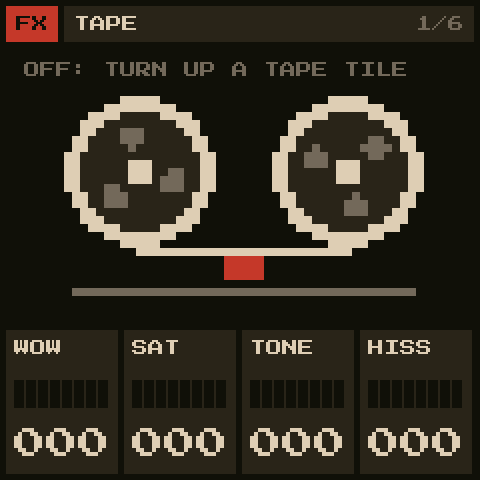

**FX** steps through **TAPE → GRAIN → DELAY → SPACE → MASTER → DRIVE**.

| Page | KNOB 1 | KNOB 2 | KNOB 3 | KNOB 4 |
|---|---|---|---|---|
| TAPE | WOW (random slips) | SATURATION | TONE | HISS |
| GRAIN | SIZE | DENSITY | SCATTER | MIX |
| DELAY | TIME | FEEDBACK | WEAR | MIX |
| SPACE | SIZE (to ~32 s, then INF) | DAMP | MIX | PRE-DELAY |
| MASTER | CUTOFF | RESONANCE | TYPE (LP / HP / BP) | POSITION (PRE FX / POST REVERB / END) |
| DRIVE | AMOUNT | TYPE (SOFT / FUZZ / CLIP / FOLD) | TONE | MIX |

- GRAIN and DELAY pour into SPACE. The tape works per track (MIXER 1's TAPE tile); DRIVE and MASTER act on the mix.
- **DELAY** is a tape echo: **WEAR** darkens and wobbles each repeat, **FEEDBACK** past the middle keeps them coming.
  For dub: TIME on a dotted eighth, FEEDBACK high, the cross-stick's DELAY send up.
- **MASTER** filters everything, in stereo; sweep it for the dub's filter moves. **DRIVE** distorts after SPACE, with a
  limiter after it.
- MASTER and DRIVE belong to the project; each track's filter TYPE and POS belong to the track. The spring reverb, the
  THROW and VERSION of the dub desk come in a later version.

---

## 10. Performance: hold FX

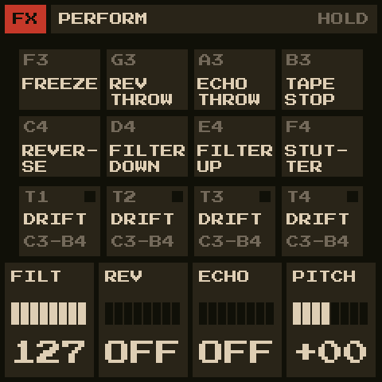

**Hold FX** and the PERFORM screen appears. Each trick lasts while you hold its key; the sequencer keeps running.

| F3 | G3 | A3 | B3 | C4 | D4 | E4 | F4 |
|---|---|---|---|---|---|---|---|
| FREEZE | REV THROW | ECHO THROW | TAPE STOP | REVERSE | FILTER DOWN | FILTER UP | STUTTER |

**ECHO THROW** and **REV THROW** are the dub engineer's throws: everything into the echo or the reverb while you hold,
the tail carries on when you let go. FREEZE is the exception: tap it to hold the grain cloud, tap again to release.

### GENERATE: hold FX + a black key

A track plays random notes of the SCALE by itself (on a DRUM track: random drums), on the tempo, whether the sequencer
plays or not.

| Hold FX + | F#3 | G#3 | A#3 | C#4 | D#4 | F#4 | G#4 | A#4 |
|---|---|---|---|---|---|---|---|---|
| | T1 | T2 | T3 | T4 | MODE | OCTAVE − | OCTAVE + | RANGE |

- A track's key, tapped: GENERATE on or off for that track. **D#4, F#4, G#4, A#4** with a track's key held: that
  track's MODE, OCTAVE or RANGE; alone: all four tracks.
- **MODE:** **DRIFT** (few, long, soft notes), **PULSE** (a melody on eighths), **STORM** (dense sixteenths).
- While a track generates, its own pattern runs silently underneath and comes back in time when you switch it off.
  Tracks generating together share the six voices fairly. Nothing is saved: after power-on GENERATE is off.

---

## 11. System: hold HOME

**Hold HOME** opens **SYSTEM**; press HOME again for **SYSTEM 2**, again for **SYSTEM 3**. These belong to the
device, not the project.

| SYSTEM | SYSTEM 2 | SYSTEM 3 |
|---|---|---|
| 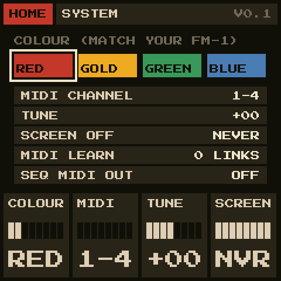 | 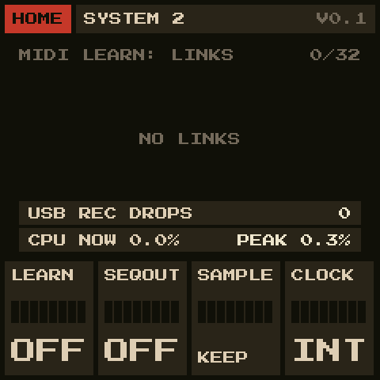 | 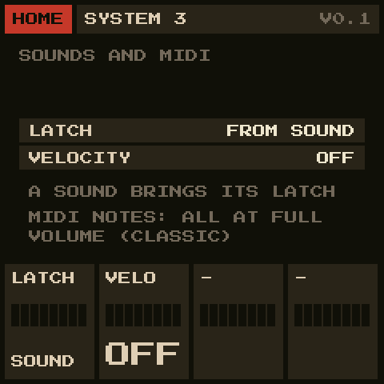 |

| Page | KNOB 1 | KNOB 2 | KNOB 3 | KNOB 4 |
|---|---|---|---|---|
| SYSTEM | COLOUR (RED, GOLD, GREEN, BLUE) | MIDI CHANNEL | TUNE (±50 cents) | SCREEN OFF |
| SYSTEM 2 | MIDI LEARN | SEQ MIDI OUT | SAMPLES | CLOCK |
| SYSTEM 3 | LATCH | VELOCITY | – | – |

- **COLOUR:** the accent, in the poster inks.
- **MIDI CHANNEL:** `1-4` puts T1–T4 on channels 1–4 (or higher, up to `13-16`); `ALL > SEL` sends every channel to the
  selected track; `CH n > SEL` only that channel. The same for USB and the TRS jack.
- **MIDI LEARN:** set LEARN, turn a knob on the FM-1, then move a knob on your controller (up to 32 links).
- **SEQ MIDI OUT:** the sequencer's and arp's notes out over USB, each track on its channel (the live view shows them).
- **SAMPLES:** RESTORE + **OCT+** writes the four factory samples back into the slots.
- **CLOCK:** `INT` (the FM-1's tempo), `INT+OUT` (and MIDI clock out over USB: START, STOP, 24 pulses a beat), `USB` or
  `TRS` (follow a MIDI clock coming in; HOME shows `EXT` and the tempo).
- SYSTEM 2 shows the processor load (CPU NOW / PEAK) and **USB REC DROPS**; OCT− + OCT+ resets both.
- **LATCH** (SYSTEM 3): `FROM SOUND` (a sound brings its own LATCH) or `ALWAYS OFF`.
- **VELOCITY** (SYSTEM 3): `OFF`, every note at full volume (`CLASSIC`); `ON`, a MIDI note plays as hard as it was
  played. Turn it on for ghost notes and accents on the drums from a DAW.

---

## 12. Combos at a glance

| Hold | + | Does |
|---|---|---|
| EDIT | OCT− / OCT+ | Undo / redo |
| FX | white keys F3–F4 | Performance tricks (FREEZE … STUTTER) |
| FX | black key F#3 / G#3 / A#3 / C#4, tapped | GENERATE on/off for T1 / T2 / T3 / T4 |
| FX | a track's black key + D#4 / F#4 / G#4 / A#4 | That track's GENERATE MODE / OCTAVE − / OCTAVE + / RANGE |
| SEL | (alone, let go) | Chord mode on/off |
| SEL | a knob (sequencer pages) | Lock that value to the selected step |
| SEL | OCT− (sequencer pages) | Clear the step's locks |
| SEL | OCT+ | The selected track's LATCH on/off |
| SEQ | white keys F3–F4 | Sequencer tools |
| SEQ | turn SELECT | Pattern length |
| SAVE | F3–B3 / C4–F4 | Recall / save slots A–D |
| GLO | F3–B3 / C4–F4 | Mute / solo T1–T4 |
| ARP | (alone) | Arpeggiator on/off |
| REC | (alone, ~1 s) | Clear the selected track's pattern |
| HOME | (alone) | System settings |
| — | OCT− + OCT+ together | Reset CPU PEAK and USB REC DROPS |

---

## 13. Factory sounds

Turn **PRESETS** to step through them by category, then your own.

| Category | Sounds |
|---|---|
| DRONE | Monk Drone, Abyss, Iron Lung, Tomb Hum, Sub Drone, Deep Well |
| PAD | Crypt Pad, Ash Veil, Frozen Hall, Last Light, Moss, Black Velvet |
| BELL | Iron Bell, Funeral Chime, Rust Gong, Glass Harp, Bowed Bell, Shrine |
| ORGAN | Funeral Organ, Chapel |
| KEYS | Dead Harpsichord, Music Box, Cathedral Keys, Bone Piano, Wraith, Lantern, Spider Pluck, Lute, Candle |
| TEXTURE | Sea Breeze |
| DRUMS | One Drop Kit, Rockers Kit, Steppers Kit, Dub Kit, Rub-a-Dub Kit, Rocksteady Kit, Deep Roots Kit, Tight Kit, Boomy Kit |
| OTHER | Haunted Strings, Dungeon Brass, War Horn, Cello Grave, Sorrow Strings |

The nine DRUM kits are RIDDIM's own (PRESETS 31–39); the other sounds come from the engine RIDDIM grew from and are
replaced by roots sounds (sub bass, skank guitar, bubble organ, melodica, horns) in a later version. Factory sounds
never switch chord mode on when you load them; WAR HORN keeps a FIFTH chord for when you do.

**Listen** to the nine kits, and play the 27 keys, on [the RIDDIM site](https://saulofilho.github.io/riddim-fm1/#listen).

---

## 14. The editor

**[saulofilho.github.io/riddim-fm1/emu/editor.html](https://saulofilho.github.io/riddim-fm1/emu/editor.html)**, in
Chrome or Edge on a computer. Connect the FM-1 over USB, press **CONNECT FM-1 (USB)** and allow MIDI when the browser
asks. **TRY WITHOUT AN FM-1** runs RIDDIM's own code in the page instead.

- **SOUND EDITOR:** the four tracks' sounds, every setting with the FM-1's names (a DRUM track: KIT, TUNE, DECAY,
  HUMAN). Every move plays on the FM-1 at once, and in the page's own RIDDIM beside it. **STORE IN SLOT** saves it.
- **SOUNDS:** your 64 slots and the 44 factory sounds; **LOAD TO T1–T4**, rename, clear, import, export.
- **SAMPLES:** drop a WAV on a slot and **UPLOAD** it; **RESTORE FACTORY SAMPLES**; **NORMALISE**.
- **SEQUENCER:** the four patterns of a slot as a grid: edit, import, send, preview in the page, save and load files.
- **FX:** the project's effects and each track's sends, live.
- **SETTINGS:** MIDI CHANNEL, CLOCK, LATCH and VELOCITY.
- **BACKUP:** one file with all your sounds, slots A–D, settings and the four samples; a restore first backs up
  what's there.

The FM-1 only writes to its memory while the sequencer is stopped and nothing sounds; nothing is written without you
pressing a button.

---

## 15. The web emulator and the live view

**[The web emulator](https://saulofilho.github.io/riddim-fm1/emu/)**: the FM-1's panel in your browser, running the
same firmware. Press **Switch on**, then play it with the mouse or the computer keyboard.

| Key | Does |
|---|---|
| `Z X C V B N M , . /` | The white keys from F3 |
| `S D F H J L ; '` | The black keys |
| `Q W E R T Y U I O` | B4 to G5 |
| `1 2 3 4 5 6` | FX, SCL (SEL), ENV, LFO, EDIT, GLO |
| `7 8 9 0 - =` | HOME, SAVE, ARP, SEQ, PLAY, REC |
| `[` `]` | OCT−, OCT+ |
| `↑` `↓` / `←` `→` | SELECT / ALGORITHM (the track) |

Hold a button's key and press other keys for combos; right-click or Shift-click a button to keep it held. It plays
MIDI from a keyboard through Web MIDI (no MIDI clock).

**[The live view](https://saulofilho.github.io/riddim-fm1/emu/live.html)** draws your FM-1 as it plays, over its USB
cable, in Chrome or Edge: **CONNECT FM-1** reads its notes and clock (USB-MIDI; turn on SEQ MIDI OUT for the steps and
arps) and, a few times a second, the selected track's sound and the effects; pick the FM-1 in **SOUND** for its audio
(the speaker boxes, the spectrum, a scope). **DEMO** plays a beat recorded from RIDDIM without an FM-1. For a stage or
a stream.

---

## 16. Good to know

- **Six voices** are shared by the tracks that play notes; a track never takes a voice another track is using. DRUM
  tracks have their own ten hits.
- **CPU FULL: NOTE DROPPED:** the FM-1 has too much to play at once; fading and generated notes go first.
- **After an unexpected restart** the header says why at power-on: `WATCHDOG RESET` or `LOW VOLTAGE RESET`.
- **MIDI IN** over USB, and on the **TRS jack** (MIDI IN only) with a TRS-to-DIN MIDI adapter. Looping MIDI from a DAW
  is handled: a note arriving again before its note-off goes on; ALL NOTES OFF lets go of every MIDI note.
- **Stuck?** Hold **OCT−** while switching on for the USB rescue, and use the Rescue page on the
  [FM-1 Firmware Hub](https://thefirmwarehub.com/).
- RIDDIM 0.1 has not been tested on an FM-1 yet: see the [README](README.md) before installing.
