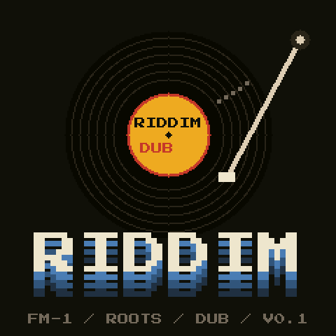
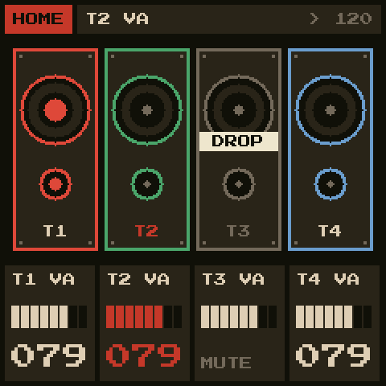

# RIDDIM

**A roots reggae firmware for the M-VAVE FM-1.** Rocksteady, one drop, rockers, steppers, and dub played live: a
whole band synthesized on the FM-1 (drums, sub bass, skank, organ bubble, melodica, horns) and a dub desk to version
the tune while it plays.

> **Version 0.1, in development.** Not released, not on the FM-1 Firmware Hub, and **not tested on an FM-1 yet**.
> Today RIDDIM is a four-track groovebox with its own name, saves and screens: the reggae band and the dub desk are
> planned, not built (see [The plan](#the-plan)). Unofficial firmware, not made or endorsed by M-VAVE.

**[The RIDDIM site](https://saulofilho.github.io/riddim-fm1/)** · **[Listen to the kits](https://saulofilho.github.io/riddim-fm1/#listen)** · **[Try it in your browser](https://saulofilho.github.io/riddim-fm1/emu/)** (the real
firmware, no FM-1 needed) · **[The editor](https://saulofilho.github.io/riddim-fm1/emu/editor.html)** · **[The live view](https://saulofilho.github.io/riddim-fm1/emu/live.html)** (your FM-1
drawn as it plays) · **[First steps guide (PDF)](docs/riddim-first-guide.pdf)** · **[The manual](MANUAL.md)**

**[Em português](README.pt.md)**

| | |
|---|---|
|  |  |

## In 0.1

- **Its own identity:** `FM-1_932`, package `riddim.fwsc`. RIDDIM keeps its own saves (projects, slots, settings,
  samples, sounds) and does not read any other firmware's.
- **Its own screens:** the NOITE palette (ink and poster paper; COLOUR in SYSTEM: RED, GOLD, GREEN, BLUE).
  - The boot screen: a record turns, the tonearm swings in and sets down, the name appears and its echoes fall
    behind it.
  - HOME: the sound system, a speaker box a track (T1 red, T2 green, T3 gold, T4 blue). The cones push with each
    track's sound; a muted track goes dark and wears a strip of tape, DROP.
- **DRUM, a roots kit** (a sound source, in the place of the old VOICE): 20 synthesized drums on 27 keys, from F3 up:
  KICK, HAT, CROSS (the cross-stick), PEDAL HAT, SNARE, OPEN HAT, RIMSHOT, the toms, SHAKER, COWBELL, STEP KICK, WOOD,
  SYNDRUM (high and low too), STICKS, SPRING (the tank shaken), FLOOR TOM, TIMBALE, RIDE, CRASH, DUB KICK. Knobs: KIT
  (STUDIO, YARD, DUB, STEPPERS), TUNE, DECAY, HUMAN (behind the beat). A hit cuts the same drum sounding (the hats
  cut each other); the kit has its own ten hits, never the six voices the other tracks share. The DRUM page draws
  the kit and lights the piece you hit. Nine factory kits in the DRUMS category: ONE DROP, ROCKERS, STEPPERS, DUB,
  RUB-A-DUB, ROCKSTEADY, DEEP ROOTS, TIGHT, BOOMY.
- **The web emulator, the editor and the live view** (`web/`): the same firmware compiled to WebAssembly; the live view
  draws an FM-1 as it plays over USB (its notes, clock, sound and knobs), with a DEMO that needs no FM-1.
- **The site** (`site/`, GitHub Pages): the nine kits recorded from the firmware with their beats drawn, the 27 keys to
  click, the screens, how to install, the tools. Its sounds and data come from the firmware in host mode
  (`tools/gen_site.py`), the manual's screens too (`tools/gen_screens.py`), the guides from `tools/gen_guide.py`.
- The groovebox under it: four tracks, seven sound sources, a 64-step sequencer per track, the arpeggiator, one-key
  chords, GENERATE, tape, grain, delay and reverb, song mode, MIDI in and out, MIDI clock. RIDDIM's own manual comes
  with the reggae features.

## The plan

[PLAN.md](PLAN.md) (in Portuguese) has the whole roadmap and its log; the mood board is in
[docs/moodboard/](docs/moodboard/index.html). In short:

- **Drum styles** (the kit is in 0.1): styles that play by themselves on a DRUM track: ONE DROP, ROCKERS, STEPPERS,
  FLYERS, ROCKSTEADY, EARLY, RUB-A-DUB, with fills and the laid-back HUMAN feel.
- **The band:** lines over the chord you hold: SKANK (the chop on 2 and 4), BUBBLE (the organ), BASS (root, fifth,
  octave and passing notes, with room to breathe), HORNS.
- **Dub:** a spring reverb, a tape echo that runs into self-oscillation, filter sweeps, THROW (a track into the echo
  while held), mutes that land on the bar, and VERSION, which mixes the dub by itself.
- **Nothing copied:** every sound synthesized, no record samples, no famous riddim transcribed. The styles and lines
  are written in the style, not taken from recordings.

## Building and testing

The FM-1 build needs the JieLi Linux toolchain (`tools/get_toolchain.sh`) and the JieLi AC79 SDK; on a Mac, Docker
running and Pillow in a virtual environment:

```
./build.sh                      # -> build/riddim.fwsc (identity FM-1_932)
```

Host mode runs the firmware on a computer: its sound as WAV, its screens as PNG, and the tests. It needs Linux (on a
Mac, in a container):

```
sh tests/run_host.sh
docker run --rm -v "$PWD":/work -w /work python:3.12-bookworm sh -c "pip install -q Pillow mido; sh tests/run_host.sh"
```

The web emulator and its test (after `tests/run_host.sh`):

```
docker run --rm -v "$PWD":/work -w /work emscripten/emsdk:3.1.74 sh web/build_web.sh    # -> web/dist/
docker run --rm -v "$PWD":/work -w /work node:22-bookworm node web/test_web.mjs
```

## Install

Not yet: 0.1 has not been on an FM-1. The first release will come with the test results from a real unit, and then
the FM-1 Firmware Hub. If you build it and install it anyway (`tools/fm1_install.py build/riddim.fwsc`), you do so
at your own risk; the Hub's Rescue page brings a stuck FM-1 back (hold **OCT-** while switching on).

## Credits

RIDDIM stands on the work of other FM-1 firmware authors. Who made what, and every licence, is in
[LICENSING.md](LICENSING.md).

## Licence

GPL-3.0-only ([LICENSE](LICENSE)); a few files are Apache-2.0 or MIT and the factory samples CC0 1.0, as
[LICENSING.md](LICENSING.md) lists. M-VAVE and FM-1 are trademarks of their owners.
