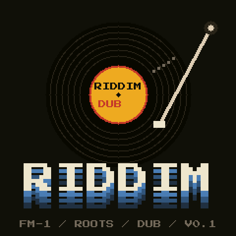
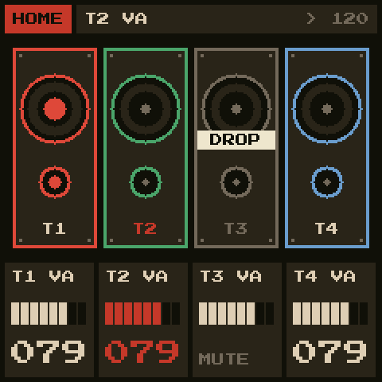

# RIDDIM

**Um firmware de reggae roots para o M-VAVE FM-1.** Rocksteady, one drop, rockers, steppers e dub tocado ao vivo: a
banda inteira sintetizada no FM-1 (bateria, baixo de sub, skank, bubble de órgão, melódica e metais) e uma mesa de
dub para "versionar" a música enquanto ela toca.

> **Versão 0.1, em desenvolvimento.** Sem release, fora do FM-1 Firmware Hub e **ainda não testada num FM-1**. Hoje o
> RIDDIM tem a banda (o kit DRUM, o baterista do GROOVE, as linhas sobre o acorde que você segura, 35 sons roots); a
> mesa de dub está planejada, não feita (ver [O plano](#o-plano)). Firmware não oficial, não feito nem endossado pela M-VAVE.

**[O site do RIDDIM](https://saulofilho.github.io/riddim-fm1/)** · **[Ouça os kits](https://saulofilho.github.io/riddim-fm1/#listen)** · **[Toque no navegador](https://saulofilho.github.io/riddim-fm1/emu/)** (o firmware de
verdade, sem precisar de FM-1) · **[O editor](https://saulofilho.github.io/riddim-fm1/emu/editor.html)** · **[A visão ao vivo](https://saulofilho.github.io/riddim-fm1/emu/live.html)** (seu
FM-1 desenhado enquanto toca) · **[Guia de primeiros passos (PDF)](docs/riddim-guia.pdf)** · **[O manual](MANUAL.md)** (em inglês)

**[In English](README.md)**

| | |
|---|---|
|  |  |

## Na 0.1

- **Identidade própria:** `FM-1_932`, pacote `riddim.fwsc`. O RIDDIM guarda seus próprios saves (projetos, slots,
  ajustes, samples, sons) e não lê os de nenhum outro firmware.
- **Telas próprias:** a paleta NOITE (tinta e papel de cartaz; COLOUR no SYSTEM: RED, GOLD, GREEN, BLUE).
  - A tela de boot: o compacto gira, o braço desce e assenta, o nome aparece e os ecos caem atrás dele.
  - A HOME: o sound system, uma caixa de som por trilha (T1 vermelho, T2 verde, T3 ouro, T4 azul). Os cones empurram
    com o som de cada trilha; uma trilha muda apaga e leva uma fita, DROP.
- **DRUM, um kit roots** (uma fonte de som, no lugar da antiga VOICE): 20 tambores sintetizados em 27 teclas, de F3
  para cima: KICK, HAT, CROSS (o cross-stick), PEDAL HAT, SNARE, OPEN HAT, RIMSHOT, os tons, SHAKER, COWBELL, STEP
  KICK, WOOD, SYNDRUM (agudo e grave também), STICKS, SPRING (a mola chacoalhada), FLOOR TOM, TIMBALE, RIDE, CRASH, DUB
  KICK. Knobs: KIT (STUDIO, YARD, DUB, STEPPERS), TUNE, DECAY, HUMAN (atrás do tempo). Um golpe corta o mesmo tambor
  soando (os chimbais cortam um ao outro); o kit tem seus próprios dez golpes, nunca as seis vozes que as outras
  trilhas dividem. A página DRUM desenha o kit e acende a peça tocada. Nove kits de fábrica na categoria DRUMS: ONE
  DROP, ROCKERS, STEPPERS, DUB, RUB-A-DUB, ROCKSTEADY, DEEP ROOTS, TIGHT, BOOMY. **Natural, não máquina:** nenhum golpe
  igual ao outro (cada um um pouco diferente em afinação, volume e duração), e a força está no som (golpe fraco mais
  escuro e curto).
- **GROOVE, o baterista** (EDIT › GROOVE numa trilha DRUM): oito estilos roots que a trilha toca sozinha enquanto o
  sequenciador roda: ONE DROP, ROCKERS, STEPPERS, FLYERS, ROCKSTEADY, EARLY, RUB-A-DUB, DUB, dois compassos cada, com
  duas viradas. PARTS divide o estilo entre trilhas (DRUMS, HATS, EXTRAS), FILL a cada 2, 4 ou 8 compassos, FEEL o
  swing. Toca como um baterista: o cross-stick atrás do tempo, ghost notes que vêm e vão, a força de cada golpe um pouco
  diferente. Cada kit de fábrica traz o seu estilo: carregue e aperte PLAY. Salvo com o som e com o projeto.
- **As linhas da banda** (ARP, depois do CHORD): sobre o acorde que você segura, dois compassos cada: SKANK (o corte
  no 2 e no 4), BUBBLE (o "bub-ble" do órgão), BASS (o do one drop, com espaço), STEP BASS (nos tempos), HORNS (uma
  resposta no fim da frase). Tocadas como músicos: cada nota atrás do tempo pelo seu instrumento, força e duração um
  pouco diferentes, ghosts que vêm e vão. Os sons que trazem uma linha ligam o ARP ao carregar: segure um acorde, a
  banda toca.
- **35 sons roots** (todos do RIDDIM, em oito categorias): SUB, ROUND, DUB e STEPPER BASS, MELODICA, VIBES, MARIMBA,
  HORN LINE, BUBBLE e ROCK ORGAN, SKANK PIANO, UPRIGHT PIANO, CLAV, SKANK, FM e NYLON GUITAR, HORNS, DUB SIREN e
  outros; quatro patches FM novos (BRASS, PIANO, GUITAR, BASS). Cada nota um pouco fora da afinação por si (como um
  instrumento tocado; não o órgão de tonewheel).
- **O emulador web, o editor e a visão ao vivo** (`web/`): o mesmo firmware compilado para WebAssembly; a visão ao
  vivo desenha um FM-1 enquanto ele toca pelo USB (notas, clock, som e knobs), com um DEMO que não precisa de FM-1.
- **O site** (`site/`, GitHub Pages): os nove kits gravados do firmware com as batidas desenhadas, as 27 teclas para
  clicar, as telas, como instalar, as ferramentas. Sons e dados saem do firmware em modo host (`tools/gen_site.py`), as
  telas do manual também (`tools/gen_screens.py`), os guias de `tools/gen_guide.py`.
- A groovebox por baixo: quatro trilhas, sete fontes de som, sequenciador de 64 passos por trilha, arpejador, acorde
  numa tecla, GENERATE, tape, grain, delay e reverb, modo song, MIDI de entrada e saída, MIDI clock. O manual próprio
  do RIDDIM vem com os recursos de reggae.

## O plano

O [PLAN.md](PLAN.md) tem o roteiro inteiro e o andamento; o mood board está em
[docs/moodboard/](docs/moodboard/index.html). Em resumo:

- **Dub:** reverb de mola, eco de fita que chega à auto-oscilação, varredura de filtro, THROW (a trilha vai para o
  eco enquanto você segura), mutes que entram no compasso e VERSION, que mixa o dub sozinho.
- **Nada copiado:** todo som sintetizado, nenhum sample de disco, nenhum riddim famoso transcrito. Estilos e linhas
  são escritos no estilo, não tirados de gravações.

## Compilar e testar

O build para o FM-1 precisa do toolchain JieLi para Linux (`tools/get_toolchain.sh`) e do SDK AC79 da JieLi; no Mac,
o Docker ligado e o Pillow num ambiente virtual:

```
./build.sh                      # -> build/riddim.fwsc (identidade FM-1_932)
```

O modo host roda o firmware no computador: o som em WAV, as telas em PNG, e os testes. Precisa de Linux (no Mac, num
contêiner):

```
sh tests/run_host.sh
docker run --rm -v "$PWD":/work -w /work python:3.12-bookworm sh -c "pip install -q Pillow mido; sh tests/run_host.sh"
```

O emulador web e o teste dele (depois do `tests/run_host.sh`):

```
docker run --rm -v "$PWD":/work -w /work emscripten/emsdk:3.1.74 sh web/build_web.sh    # -> web/dist/
docker run --rm -v "$PWD":/work -w /work node:22-bookworm node web/test_web.mjs
```

## Instalar

Ainda não: a 0.1 nunca rodou num FM-1. A primeira release vem com os resultados do teste num aparelho de verdade, e
depois o FM-1 Firmware Hub. Se você compilar e instalar mesmo assim (`tools/fm1_install.py build/riddim.fwsc`), é por
sua conta e risco; a página Rescue do Hub recupera um FM-1 travado (segure **OCT-** ao ligar).

## Créditos

O RIDDIM se apoia no trabalho de outros autores de firmware para o FM-1. Quem fez o quê, e cada licença, está no
[LICENSING.md](LICENSING.md).

## Licença

GPL-3.0-only ([LICENSE](LICENSE)); alguns arquivos são Apache-2.0 ou MIT e os samples de fábrica CC0 1.0, como lista
o [LICENSING.md](LICENSING.md). M-VAVE e FM-1 são marcas dos seus donos.
